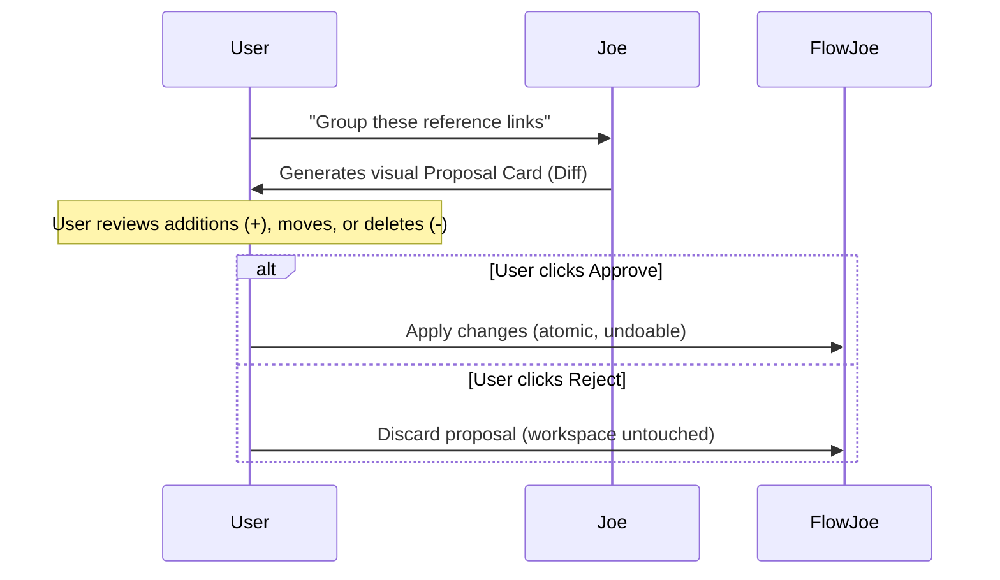

Many modern tools use AI to silently rewrite your documents or generate text without your oversight. 

FlowJoe introduces **Joe**—an AI collaborator designed around absolute transparency, operating strictly within a trust model you define.

---

## The Propose-Approve Safety Loop

The core philosophy of Joe is simple: **AI proposes, you approve.** 

When you ask Joe to make changes to your workspace—such as organizing tags, generating design drafts, or restructuring a messy outline—Joe creates an interactive **Proposal Card**.

- **Visual Diff:** You see exactly what Joe wants to add, move, or rename before it happens.
- **Single-Click Undo:** If you approve a change and decide you don't like it, pressing `Cmd/Ctrl+Z` rolls back the entire AI operation instantly.
- **Zero Silent Overwrites:** Joe can never alter your tree or files in the background without your explicit confirmation.

---

## How Joe Helps You Build

Joe is equipped with a deep flow-mutation API consisting of **56 verbs** across multiple areas:
* **Autorestructure outlines:** Ask Joe to reorganize branches based on topics.
* **A node's look and its gallery:** Ask Joe to give a node a Theme-menu look by name, copy a slot or a stack item without moving the original, crop a picture, make a PDF of a picture or a note, set album art, color a canvas slot, or draw and remove lines on that board. Each change still waits for your approval.
* **Smart Stacking:** Direct Joe to group similar assets or drafts into stacks.
* **Document and Image Analysis:** Send PDFs, spreadsheets, or graphics to Joe for deep summaries and text extraction.
* **Spellcheck Diffing:** Clean up grammar using a side-by-side diff review modal.

<Accordion title="Technical Details: Developer & Agent Integration">
FlowJoe exposes Joe's capabilities to external terminal tools (like Claude Code, Codex, or Gemini CLI) via a loopback **Model Context Protocol (MCP)** server. 

This lets you drive your visual FlowJoe workspace directly from your terminal. External command-line scripts can call:
- `get_flow_snapshot` to inspect the tree.
- `propose_flow_patch` to execute structural edits under the same propose-approve seatbelt protection.
</Accordion>
