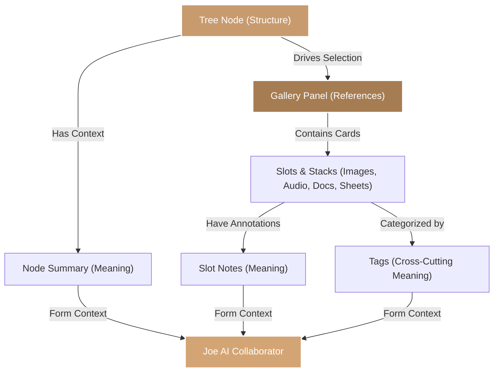

Many productivity tools force you into a compromise: you either get a clean text outline with no visual files, or a messy visual canvas where structure is lost. 

FlowJoe is designed differently. Every workspace is built around a powerful, unified triad: **Structure**, **References**, and **Meaning**.

---

## The Triad at a Glance

| Layer | The Surface | What it Solves | What Lives Here |
| :--- | :--- | :--- | :--- |
| **Structure** | **The Tree** (Left Hemisphere) | *Where does this live?* | Hierarchy, nesting, task status, visual branch colors |
| **References** | **The Gallery** (Right Hemisphere) | *What am I citing or looking at?* | Images, audio, videos, PDFs, spreadsheets, calendars |
| **Meaning** | **Notes, Summaries & Tags** | *What does this mean for the project?* | Node summaries, slot notes, cross-cutting metadata |

---

## 1. Structure: The Hierarchy

The left side of the app is your **Tree**. Unlike static folder outlines on your computer, a node in FlowJoe is not just a folder path—it is a **living container** for your ideas. Nest children as deeply as you need to map out milestones, world-building elements, or research topics.
- **Visual Branch Colors:** Highlight parent branches to create distinct zones (e.g. orange for draft phases, green for published chapters).

## 2. References: The Media Gallery

When you click any node in your tree, its **Gallery** slides open on the right. This is where your reference material lives. It keeps files, interactive documents, and web links side-by-side without cluttering your outline. 
- **Layouts for every mood:** View references in a horizontal mood-board grid, a vertical streaming reader, or a side-by-side editing layout.

## 3. Meaning: Intent & Synthesis

Meaning is the intelligence layer you add on top of your raw references. A project is more than just a list of files; it is about *intent*:
- **Node Summaries:** The overarching executive overview of what is happening in a branch.
- **Slot Notes:** Annotations attached directly to files explaining why they were saved.
- **Tags:** Labels that cross-cut your tree, letting you build dynamic search views instantly.

> [!TIP]
> **How Joe Leverages the Triad:** Joe (your AI collaborator) respects this split. When you ask Joe a question, he reads the **Structure** to understand your outline, inspects the **References** (like reading a spreadsheet or analyzing image pixels), and anchors his answer on your custom **Meaning** (notes and summaries) to write contextually intelligent proposals.
